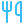
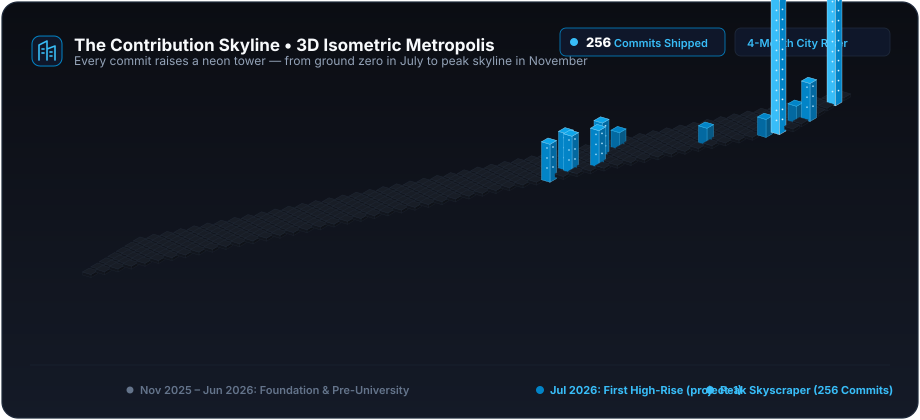
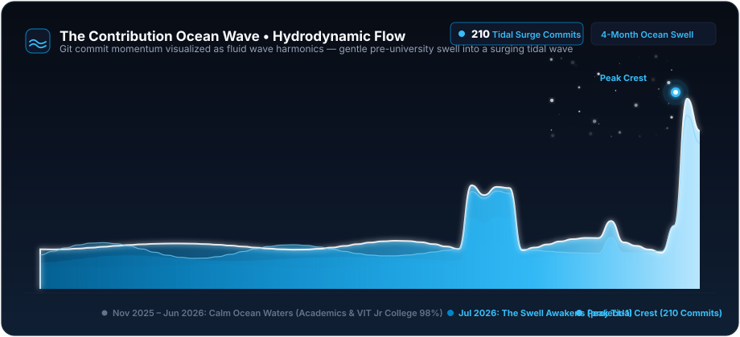
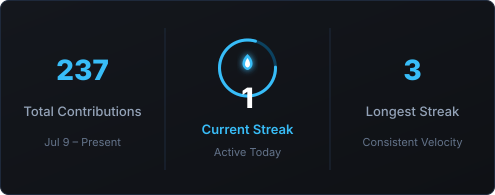

<!-- Animated Header Typing SVG (Clean Professional Typography) -->

  <strong>Frontend Developer specializing in tactile UI architectures, Neumorphic design systems, and zero-bloat browser applications.</strong>

<!-- Quick Action Badges -->

  
  
  
  

<!-- Metric Highlights -->

  
  
  
  

---

###  About Me

> *"Great frontend engineering is where clean architecture meets tactile craftsmanship."*

-  **Undergraduate Education**: 1st-Year B.Tech student in Information Technology at **[Shri Vishnu Engineering College for Women (SVECW)](https://www.linkedin.com/school/15124808/)**, Bhimavaram *(Expected Graduation: 2029–30)*.
-  **Accelerated Trajectory**: Began focused frontend engineering in July 2026 authoring [`project-1`](https://github.com/sksameera321/project-1) after achieving **98% (982/1000)** in Intermediate at VIT Junior College and qualifying AP EAMCET. Over a 4-month development sprint, engineered and deployed 6+ full-featured web applications.
-  **Tactile Design Systems**: Dedicated to physical UI paradigms &mdash; **Neumorphism (Soft UI)** dual-shadow systems, skeuomorphic physical controls, and **HTML5 Canvas FlowField** vector particles.
-  **Core Principles**: Semantic HTML5 accessibility (a11y), responsive mobile-first architecture, zero runtime bloat, and performant vanilla JavaScript.
-  **Location**: India *(Open to remote software engineering internships and developer collaborations globally)*.

---

###  Technical Stack & Tooling

<!-- Rounded Developer Icons -->

  

| Core Domain | Technologies & Capabilities |
|:---|:---|
| **Frontend Core** | `JavaScript (ES6+)` • `TypeScript` • `Semantic HTML5` • `CSS3 (Grid/Flexbox)` • `DOM APIs` |
| **Frameworks & UI** | `React.js` • `Next.js Fundamentals` • `Tailwind CSS` • `Bootstrap` • `Canvas 2D API` |
| **Tactile Design Systems** | `Neumorphism (Soft UI)` • `Skeuomorphism` • `View Transitions API` • `Responsive Layouts` |
| **Tooling & Workflow** | `Git & GitHub` • `GitHub Pages (CI/CD)` • `VS Code` • `RESTful APIs` • `LocalStorage` |

---

###  Featured Engineering Projects

<table>
  <tr>
    <td width="50%" valign="top">
      <h3> <a href="https://sksameera321.github.io/interactive-resume-portfolio/">Interactive Neumorphic Portfolio</a></h3>
      
Tactile Soft UI developer portfolio featuring Kokonut UI 3D CardStack, HTML5 Canvas particle flow dynamics, and a printable single-column ATS resume.

      
<strong>Stack:</strong> <code>Vanilla JS</code> • <code>CSS3 Neumorphism</code> • <code>Canvas API</code> • <code>SEO/AEO</code>

      

        <a href="https://sksameera321.github.io/interactive-resume-portfolio/"> <b>Live Demo</b></a> &bull;
        <a href="https://github.com/sksameera321/interactive-resume-portfolio"> <b>Source Code</b></a> &bull;
        <a href="https://drive.google.com/file/d/1OWFJUhRv1ZI_E-PanuBKt-h2xUL3qeXV/view"> <b>Video Demo (0:37)</b></a>
      

    </td>
    <td width="50%" valign="top">
      <h3> <a href="https://github.com/sksameera321/my-amazon-project">Amazon Storefront Architecture</a></h3>
      
High-fidelity e-commerce clone featuring interactive catalog navigation, category search filtering, shopping cart state persistence via LocalStorage, and responsive checkout flows.

      
<strong>Stack:</strong> <code>HTML5</code> • <code>CSS3 Flexbox</code> • <code>JavaScript</code> • <code>LocalStorage</code>

      

        <a href="https://github.com/sksameera321/my-amazon-project"> <b>Source Code</b></a> &bull;
        <a href="https://drive.google.com/file/d/1vBxMT2haRQDCjNWgYsZ4KhKN909NZv04/view"> <b>Video Demo (0:15)</b></a>
      

    </td>
  </tr>
  <tr>
    <td width="50%" valign="top">
      <h3> <a href="https://github.com/sksameera321/my-kiya.in">Restaurant Menu & Ordering System</a></h3>
      
Interactive dining menu platform with food category navigation, dietary filtering, real-time price calculation, and mobile-first responsive layout.

      
<strong>Stack:</strong> <code>JavaScript</code> • <code>CSS Grid / Flexbox</code> • <code>DOM Manipulation</code>

      

        <a href="https://github.com/sksameera321/my-kiya.in"> <b>Source Code</b></a> &bull;
        <a href="https://drive.google.com/file/d/12rQlzYPinf89SOhVtE6lbwoPuD80IWwC/view"> <b>Video Demo (0:24)</b></a>
      

    </td>
    <td width="50%" valign="top">
      <h3> <a href="https://github.com/sksameera321/hub">Game Hub Arcade Portal</a></h3>
      
Curated browser gaming portal featuring active state management, responsive canvas and DOM rendering, and persistent high scores.

      
<strong>Stack:</strong> <code>JavaScript</code> • <code>Canvas API</code> • <code>Game Loops</code> • <code>CSS Animations</code>

      

        <a href="https://github.com/sksameera321/hub"> <b>Source Code</b></a> &bull;
        <a href="https://drive.google.com/file/d/1Ia3XCRzb9veiDdnWv--5ELKrrxatajaT/view"> <b>Video Demo (0:21)</b></a>
      

    </td>
  </tr>
  <tr>
    <td width="50%" valign="top">
      <h3> <a href="https://github.com/sksameera321/Ai-hub">AI Tools Directory Hub</a></h3>
      
Developer index aggregating modern AI services and tools by domain, pricing model, and capabilities with dynamic client-side search filtering.

      
<strong>Stack:</strong> <code>JavaScript</code> • <code>REST APIs</code> • <code>JSON Data</code> • <code>Responsive CSS</code>

      

        <a href="https://github.com/sksameera321/Ai-hub"> <b>Source Code</b></a> &bull;
        <a href="https://drive.google.com/file/d/1sZB9c1j2Q6eUAvfUvzlQ_1pTnuAzO-9f/view"> <b>Video Demo (0:20)</b></a>
      

    </td>
    <td width="50%" valign="top">
      <h3> <a href="https://github.com/sksameera321/my-game-project">Rock Paper Scissors Interactive</a></h3>
      
Classic strategy game featuring algorithmic move generation, score tracking, fluid CSS keyframe animations, and full keyboard navigation support.

      
<strong>Stack:</strong> <code>JavaScript</code> • <code>DOM Events</code> • <code>CSS Animations</code>

      

        <a href="https://github.com/sksameera321/my-game-project"> <b>Source Code</b></a> &bull;
        <a href="https://drive.google.com/file/d/10ZMaAQo4xXNs3P36zQYvPwB21Pd2r3Fh/view"> <b>Video Demo (0:31)</b></a>
      

    </td>
  </tr>
</table>

---

###  Engineering Velocity & Activity Visualizers

<!-- Visualizer 1: 3D Isometric City Skyline (Buildings) -->

  

<!-- Visualizer 2: Hydrodynamic Ocean Wave -->

  

  
  &nbsp;&nbsp;
  
    
  

---

###  Connect & Inquiries

Actively open for <strong>Frontend Developer</strong> internships, client projects, and software engineering collaborations.

&nbsp;

&nbsp;

&nbsp;

  
Crafted with precision &bull; &copy; 2026 Sameera Bhanu

